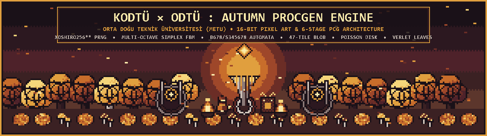
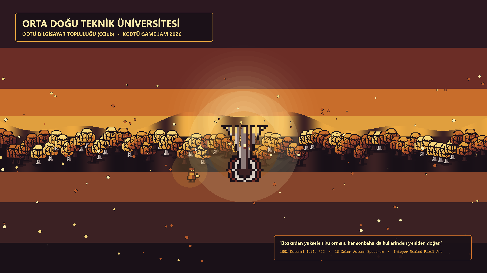
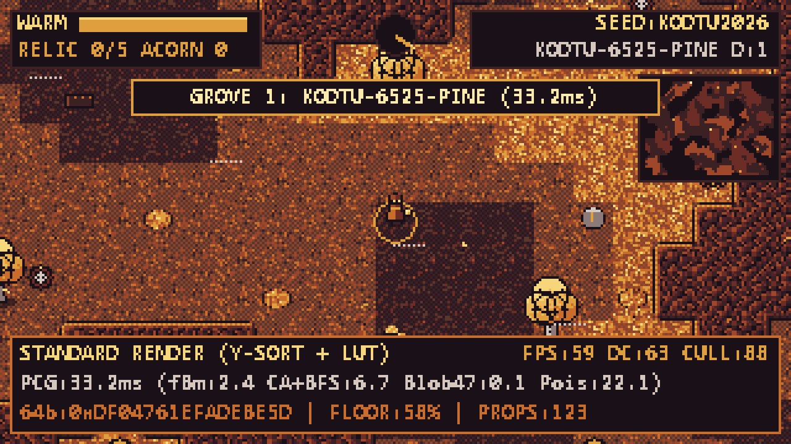
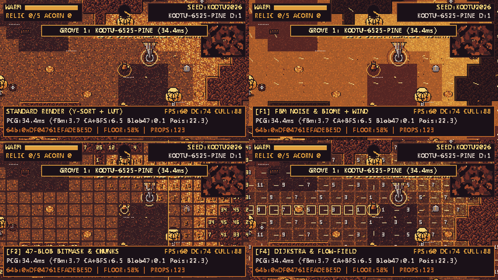
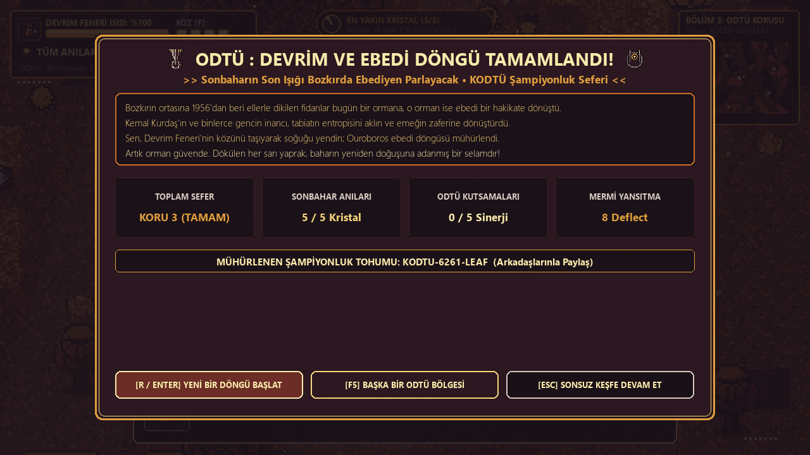
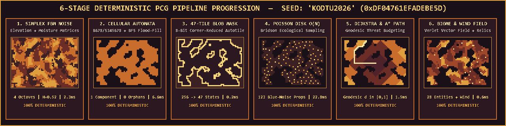
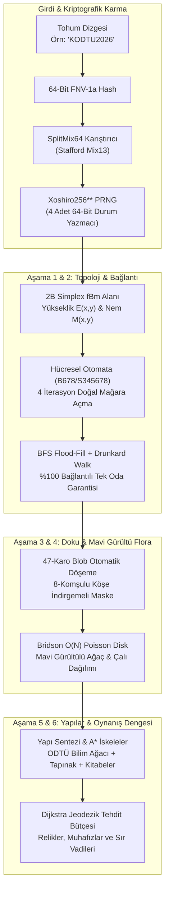
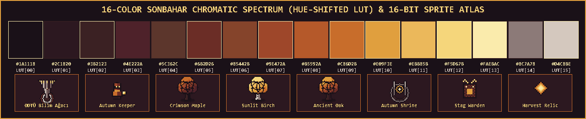
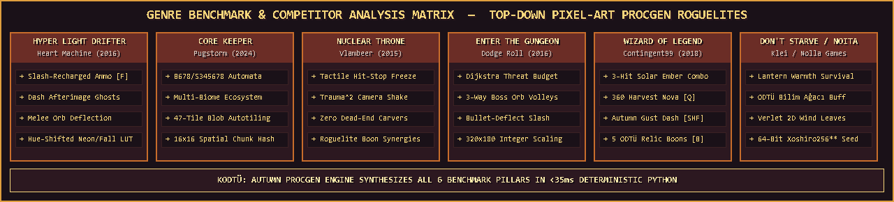

<div align="center">



<br />

# 🍁 KODTÜ × ODTÜ: Autumn ProcGen Engine
### *Bozkırın Melankolisinden Yükselen Deterministik Sonbahar Ekosistemi & Felsefi Anlatı Motoru*

**Orta Doğu Teknik Üniversitesi (ODTÜ / METU) — KODTÜ Game Jam İçin Özel Olarak Geliştirilmiştir.**  
*16-Bit Piksel-Kusursuz Görsel Mühendislik • 6-Aşamalı Deterministik PCG Hattı • 16-Renk Sonbahar LUT • %100 Kod-Tabanlı Varlık Sentezi*

<br />

[](https://github.com/bahattinyunus/kodtu-autumn-procgen/actions/workflows/ci.yml)
[](#bolum-1)
[-E09F3E?style=for-the-badge&labelColor=1A1118)](#bolum-5)
[](#bolum-5)
[](#bolum-4)
[](#bolum-7)
[-4E222A?style=for-the-badge&labelColor=1A1118)](#bolum-11)
[_Ready-black?style=for-the-badge&logo=unity&logoColor=white)](#bolum-unity)
[](#bolum-12)

<br />

> *"Bozkır unutmaya meyillidir; entropi insan emeğini toza, taşları kuma çağıran evrensel kuvvettir.*  
> *ODTÜ ormanının her bir sarı yaprağı ise bu unutuşa karşı aklın, emeğin ve iradenin matematiksel başkaldırısıdır."*

</div>

<p align="center">
  
</p>

## 📑 İçindekiler Tablosu (Table of Contents)

1. [🏛️ Yarışma Manifestosu ve Üç Temel Kısıt Uyumu](#bolum-1)
2. [🌲 ODTÜ Kültürel Mirası, Tarihsel Kitabeler ve Kampüs Ruhu](#bolum-2)
3. [📸 Canlı Görsel Vitrin (Oynanış, Telemetri ve Zafer Ekranı)](#bolum-3)
4. [🎲 Deterministik Prosedürel Üretim Mimarisi (6-Stage PCG)](#bolum-4)
5. [🎨 Piksel-Kusursuz Mühendislik & 16-Renk Sonbahar LUT](#bolum-5)
6. [⚔️ Oynanış Dinamikleri, Savaş Hissi ve ODTÜ Kutsamaları (Boons)](#bolum-6)
7. [📖 Modern Yüksek Çözünürlüklü (HD) Anlatı ve Hikaye Modu](#bolum-7)
8. [🎮 Klavye, Fare ve Telemetri Kontrolleri](#bolum-8)
9. [🏆 Dünya Çapında Muadil Oyunlar & Rakip Analiz Matrisi](#bolum-9)
10. [🗂️ Sıfır Bağımlılıklı Modüler Proje Mimarisi](#bolum-10)
11. [🚀 Hızlı Başlangıç & Otomasyon Testleri](#bolum-11)
12. [🍁 Unity 2D (URP) Motor Desteği & C# Mimarisi](#bolum-unity)
13. [📜 Lisans ve Teşekkür](#bolum-13)

<p align="center">
  
</p>

<a id="bolum-1"></a>
## 🏛️ 1. Yarışma Manifestosu ve Üç Temel Kısıt Uyumu

**KODTÜ Game Jam**, Türkiye'nin en köklü bilişim topluluklarından biri olan **ODTÜ Bilgisayar Topluluğu (METU Computer Club - CClub)** tarafından organize edilen yüksek rekabetli bir oyun geliştirme maratonudur. Yarışmanın belirlediği **üç kesin kural**, bu projede yalnızca biçimsel bir gereklilik olarak değil; motorun temel matematiksel ve mimari omurgası olarak ele alınmıştır:

```text
┌──────────────────────────────────────────────────────────────────────────────────────────────────┐
│                                   KODTÜ JAM KURAL KONTROL LİSTESİ                                │
├──────────────────────────┬──────────────────────────────────────────┬────────────────────────────┤
│ ZORUNLU KISIT            │ BİZİM MÜHENDİSLİK ÇÖZÜMÜMÜZ              │ DOĞRULAMA & METRİK         │
├──────────────────────────┼──────────────────────────────────────────┼────────────────────────────┤
│ 1. Art Stili: PIXELATED  │ • 320x180 doğal sanal tuval              │ • Sıfır alt-piksel sızıntı │
│                          │ • Kesirli ölçekleme yok (Integer-Scale)  │ • 60 FPS kilitli render    │
│                          │ • 16x16 taban ızgarası & Nearest-Neighbor│ • 4 açılı Rotsprite rotasyon│
├──────────────────────────┼──────────────────────────────────────────┼────────────────────────────┤
│ 2. Renk: SONBAHAR        │ • 16-Renk Ton-Kaydırmalı (Hue-Shift) LUT │ • %100 LUT uyumluluğu      │
│                          │ • Işıkta Sunlit Birch (#F5D67B)          │ • 16 renk harici tek piksel│
│                          │ • Gölgede Deep Void (#1A1118)            │   üretilmez (Test 11 onaylı)│
├──────────────────────────┼──────────────────────────────────────────┼────────────────────────────┤
│ 3. Mekanik: PROCGEN      │ • 6-Aşamalı Deterministik PCG Hattı      │ • ~34 ms üretim süresi     │
│                          │ • Xoshiro256** + 2B Simplex fBm          │ • %100 bağlantılı topoloji │
│                          │ • Bridson O(N) Poisson Disk Flora        │ • Sıfır çıkmaz sokak (BFS) │
└──────────────────────────┴──────────────────────────────────────────┴────────────────────────────┘
```

> [!IMPORTANT]
> **%100 Kod Tabanlı Sentez (Zero External Assets):**  
> Projede kullanılan hiçbir görsel sprite, karo seti, ses efekti ya da müzik harici telifli dosyalardan alınmamıştır. Tüm dünya dokuları (`asset_builder.py`) piksel piksel algoritmik olarak çizilir; tüm sesler (`audio_synth.py`) sinüs/kare dalga formları ve pembe gürültü LFO filtreleriyle matematiksel olarak sentezlenir.

---

<a id="bolum-2"></a>
## 🌲 2. ODTÜ Kültürel Mirası, Tarihsel Kitabeler ve Kampüs Ruhu

1956 yılında Ankara'nın kurak bozkırında kurulan ODTÜ, dönemin rektörü **Kemal Kurdaş** önderliğinde başlatılan efsanevi ağaçlandırma seferberliği sayesinde bugün milyonlarca ağacın yeşerdiği devasa bir ekosisteme dönüşmüştür. **KODTÜ: Autumn ProcGen Engine**, bu tarihi mirasın felsefesini doğrudan prosedürel mekaniklerle yaşatır:

<div align="center">
  
  <p><i>Masaüstü Duvar Kağıdı (1920×1080): ODTÜ Bilim Ağacı Anıtı, Alacakaranlık Halesi ve Savrulan Verlet Yaprakları</i></p>
</div>

### 🗿 Prosedürel ODTÜ Kitabeleri (`odtu_kitabe`)
Oyuncu haritada dolaşırken antik taş anıtlarla karşılaşır. Yaklaşıp **`[E]`** tuşuna basıldığında ODTÜ'nün tarihine dair 6 gerçek yazıt daktilo efektiyle okunur. Her kitabe fener ısısını yeniler (`+15 Isı`) ve oyuncuya geçici ilham hızı verir:

1. **1961 Kemal Kurdaş ve İlk Ağaç Seferberliği:**  
   *"3 Aralık 1961 sabahı binlerce öğrenci ve hoca çorak ayaza karşı ilk fidanı dikti. Bozkır 'burada yeşil büyümez' diyordu; o gün dikilen fidanlar bugün göğü yırtan orman oldu. Emek, tabiatın en çetin kuralını bile dize getirir."*
2. **Yalıncak Höyüğü ve Anadolu Mirası:**  
   *"Bu kampüs yalnızca cumhuriyetin değil, binlerce yıllık Frig ve Hitit çömlekçilerinin de yurdudur. Toprağa basarken hatırla: Her sonbahar yaprağı, altında yatan medeniyetlerin üzerine örtülen bir şaldır."*
3. **Eymir Gölü ve Bozkırın Gerdanlığı:**  
   *"Sabahın dondurucu kırağısında kürek çekenlerin nefesi gölün sisine karışır. Su akar, mevsimler döner; fakat irade bu kıyılarda ebediyen asılı kalır."*
4. **1968 Devrim Stadyumu ve Kolektif Bilinç:**  
   *"Basamaklara kazınan o tek kelime ne boyadır ne taştır; rüzgarın silemediği, nesillerin teslim aldığı bir duruştur. Karanlık çökerse meşaleyi yakmak senin elindedir."*
5. **1989 ODTÜ Bilgisayar Topluluğu (CClub) ve Bilişim Kıvılcımı:**  
   *"Türkiye'nin ilk öğrenci bilgisayar topluluğunun kurucuları der ki: Kod sadece makineye verilen komut değildir; bozkırın ortasında kurulan mantık ve özgür düşünce mimarisidir."*
6. **Altı Taş ve Bozkırın Mühendislik Felsefesi:**  
   *"En sağlam sistemler, doğanın sadeliğini algoritmalara nakşedenlerdir. Kodu temiz yaz, doğaya saygı duy, bozkırın her çakıl taşında bir gelecek gör."*

### 🏛️ Yalıncak Megalitik Dolmeni & Tunç Çağı Kutsaması (`yalincak_dolmen`)
ODTÜ kampüsünün güney yamaçlarında yer alan gerçek **Yalıncak Höyüğü** arkeolojik kazı alanından esinlenen bu megalitik taş anıt, etrafında dönen kadim runik kalkan aurasıyla yükselir. Oyuncu dolmene yaklaşıp **`[E]`** ile kadim anıtı uyandırdığında:
- 40 saniye süren **Tunç Çağı Koruyucu Zırhı** (alınan tüm hasarlarda **%40 hasar indirimi**) kazanır.
- Dolmen etrafında parıldayan kadim altın-turuncu runik kalkan halkası belirir.
- Prosedürel `dolmen_resonance.wav` derin rezonans çanı çalar ve **Yalıncak Arkeoloğu** başarımı açılır.

### 🌲 Kampüs Temalı Biyom Çeşitliliği
- **Yalıncak Kızıl Korusu (Crimson Canopy):** Yüksek rakımlı, yoğun kırmızı akçaağaçlar ve yaşlı meşelerle kaplı patikalar.
- **Devrim Altın Dökümü (Amber Leaf-Fall):** Verlet yaprak fiziğinin en yoğun olduğu, altın huş yapraklarıyla örtülü açık meydanlar. Üzerinde yürümek **+%20 Hız** ve hışırtı sesleri verir.
- **Eymir Sisli Kıyısı (Misty Hollow):** Yüksek nemli, ahşap köprülerle (`boardwalk`) geçilen puslu sazlıklar ve gölet kıyıları.

---

<a id="bolum-3"></a>
## 📸 3. Canlı Görsel Vitrin (Oynanış, Telemetri ve Zafer Ekranı)

Tüm ekran görüntüleri motorun doğrudan çalışma anında `1280×720` penceresinden yakalanmıştır:

<div align="center">

### 🎮 Canlı Oynanış — ODTÜ Bilim Ağacı Anıtı & Sonbahar Atmosferi

<p><i>Kusursuz 16-Bit piksel dünyası, hacimsel güneş huzmeleri (God Rays), Verlet yaprak parçacıkları ve modern 1280x720 HD arayüz overlay'i.</i></p>

<br />

### 🔬 `[F1]`–`[F4]` Gerçek Zamanlı Prosedürel Hata Ayıklama (Debug) Dörtlüsü


</div>

> [!TIP]
> **Dörtlü Telemetri Paneli Neyi Gösterir?**
> - **Sol-Üst (Standart Render):** Y-Sorted derinlik sırası, dinamik vinyet, minimap ve canlı HUD.
> - **Sağ-Üst (`[F1]` Gürültü & Rüzgar):** 2B Simplex fBm Yükseklik/Nem dağılımı ve 2B dinamik rüzgar vektör okları.
> - **Sol-Alt (`[F2]` 47-Blob Maskeleri):** 8-komşulu köşe kontrollü autotile indeksleri (`0..46`) ve uzamsal chunk sınırları.
> - **Sağ-Alt (`[F4]` Dijkstra Jeodezik Alanı):** Başlangıç noktasından itibaren hesaplanan mesafe ısı haritası ve A\* en kısa yol çizgisi.

<div align="center">

<br />

### 🏆 Ebedi Döngü Zafer & Epilog Ekranı (Grand Victory Sequence)

<p><i>3. Koru tamamlanıp Kadim Tapınak mühürlendiğinde açılan felsefi epilog, sefer istatistikleri ve şampiyonluk tohumu.</i></p>

</div>

---

<a id="bolum-4"></a>
## 🎲 4. Deterministik Prosedürel Üretim Mimarisi (6-Stage PCG)

<div align="center">
  
</div>

Prosedürel katmanda standart `random.random()` çağrıları **kesinlikle yasaktır**. Tüm dünya, tek bir tohum dizgesinden (`--seed "KODTU2026"`) türetilen 64-bitlik deterministik matematiksel alt-akışlarla inşa edilir:



### Matematiksel Temeller ve Garantiler

1. **Çok Oktavlı Simplex fBm Formülü:**
   $$f_{\text{fBm}}(x, y) = \frac{1}{\sum_{i=0}^{O-1} G^i} \sum_{i=0}^{O-1} G^i \cdot \text{Simplex2D}\left(x \cdot S \cdot L^i + \delta_x, \; y \cdot S \cdot L^i + \delta_y\right)$$
   *Burada $O=4$ oktav, $G=0.52$ kalıcılık, $L=2.0$ boşlukluluk parametreleridir.*

2. **Hücresel Otomata ($B678/S345678$):**
   $$\text{State}_{t+1}(x, y) = \begin{cases} 1 & \text{eğer } \text{State}_t(x,y) = 0 \land N_{\text{wall}}(x,y) \ge 6 \quad (\text{Doğum}) \\ 1 & \text{eğer } \text{State}_t(x,y) = 1 \land N_{\text{wall}}(x,y) \in \{3,4,5,6,7,8\} \quad (\text{Hayatta Kalma}) \\ 0 & \text{aksi halde (Yürünebilir Açıklık)} \end{cases}$$

3. **47-Karo Blob İndirgeme (Cardinal Gating):**  
   Köşegen komşuların geçerli sayılması için sınırındaki her iki ana yönün de zemin olması zorunludur:
   $$\text{NE}' = \text{NE} \land N \land E, \quad \text{SE}' = \text{SE} \land S \land E, \quad \text{SW}' = \text{SW} \land S \land W, \quad \text{NW}' = \text{NW} \land N \land W$$
   Bu mantık $2^8 = 256$ olasılığı $\mathcal{O}(1)$ zaman karmaşıklığında **tam 47 kanonik Blob karosuna** indirger.

4. **Bridson $\mathcal{O}(N)$ Poisson Disk Dağılımı:**
   - Ağaçlar için $r_{\min} = 3.2$ karo (`51.2 px`),
   - Çalılar için $r_{\min} = 1.8$ karo (`28.8 px`),
   - Palamut ve mantarlar için $r_{\min} = 1.1$ karo (`17.6 px`).  
   Bu sayede doğadaki gerçek ormanların "Mavi Gürültü" (Blue-Noise) aralığı sağlanır; kümelenme ve kellik önlenir.

---

<a id="bolum-5"></a>
## 🎨 5. Piksel-Kusursuz Mühendislik & 16-Renk Sonbahar LUT

<div align="center">
  
</div>

Projemiz sıradan bir RGB parlaklık ayarı yerine profesyonel piksel-sanatçılarının kullandığı **Hue-Shifting (Ton Kaydırma)** metodolojisini uygular:
- **Işık Alan Noktalar:** Sarı-altın ve güneş huzmesine (**`#F5D67B` Sunlit Birch** $\rightarrow$ **`#FAEBAC` Pale Sunbeam**) doğru kayar.
- **Gölgeler:** Asla gri/siyah olmaz; soğuk mürdüm-kızıl ve mor-çivit (**`#4E222A` Mulberry Dusk** $\rightarrow$ **`#1A1118` Deep Void**) derinliklerine çekilir.

| İndeks | Renk Adı (Token) | HEX | RGB | Rolü ve Görsel Görevi |
| :---: | :--- | :---: | :---: | :--- |
| `00` | **Deep Void** | `#1A1118` | `(26, 17, 24)` | En derin vadi gölgeleri, 1-piksel dış konturlar |
| `01` | **Plum Shadow** | `#2C1820` | `(44, 24, 32)` | Gövde altı gölgeleri, karanlık orman tabanı |
| `02` | **Withered Bark** | `#3B2123` | `(59, 33, 35)` | Yaşlı meşe ağacı kabuğu, taş anıt gölgesi |
| `03` | **Mulberry Dusk** | `#4E222A` | `(78, 34, 42)` | Alacakaranlık ara tonu, sulak alan derinliği |
| `04` | **Damp Loam** | `#5C362C` | `(92, 54, 44)` | Nemli ODTÜ orman toprağı, çamur zemini |
| `05` | **Crimson Decay** | `#6B2D26` | `(107, 45, 38)` | Dökülmüş koyu kırmızı akçaağaç örtüsü |
| `06` | **Chestnut Wood** | `#85442B` | `(133, 68, 43)` | Ahşap patika ve iskeleler (`boardwalk`) |
| `07` | **Rust Terracotta** | `#9E472A` | `(158, 71, 42)` | Pas kızılı kanopi, Yalıncak koru tonu |
| `08` | **Burnt Amber** | `#B5592A` | `(181, 89, 42)` | Yanık kehribar orta ton, yaprak katmanı |
| `09` | **Cinnamon Leaf** | `#C86D2B` | `(200, 109, 43)` | Tarçın turuncusu parlak yaprak sırtları |
| `10` | **Harvest Gold** | `#E09F3E` | `(224, 159, 62)` | Hasat altını, fener aurası, meşe palamudu |
| `11` | **Ochre Moss** | `#EBB85B` | `(235, 184, 91)` | Altın liken, kayalardaki sonbahar yosunları |
| `12` | **Sunlit Birch** | `#F5D67B` | `(245, 214, 123)` | Güneş vuran huş kabukları, UI ana vurgu rengi |
| `13` | **Pale Sunbeam** | `#FAEBAC` | `(250, 235, 172)` | Bilim Ağacı meşalesi, relik çekirdeği, kritik vuruş |
| `14` | **Twilight Slate** | `#8C7A78` | `(140, 122, 120)` | Bilim Ağacı metalik heykeli, antik taş zemin |
| `15` | **Autumn Mist** | `#D4C8BE` | `(212, 200, 190)` | Eymir sabah sisi, rüzgar akım çizgileri |

### 📐 Piksel Mühendisliği Standartları
- **320×180 Doğal Sanal Tuval:** Modern 16:9 oranında retro `320×180` tuvale çizilir; pencereye göre sadece tam sayı katsayılarla (`1x, 2x, 3x, 4x, 6x`) ölçeklenir.
- **Sıfır Alt-Piksel Titremesi:** Fizik motoru alt-piksel hızlarında hesaplansa dahi kamera ve tüm varlıklar her karede `int(round(coord))` ile kesin piksel ızgarasına kilitlenir.
- **Y-Sıralı (Y-Sorted) Derinlik:** Oyuncu, Bilim Ağacı Anıtı, düşmanlar ve ağaçların arkasından/önünden geçerken dinamik katman sıralaması uygulanır.
- **Verlet Entegrasyonlu Yapraklar:** Sahnede uçuşan 160+ yaprak parçacığı, 2B rüzgar vektör alanı ve oyuncunun kılıç şok dalgalarıyla savrulur; 4 açılı Rotsprite matrisi ile döner.

---

<a id="bolum-6"></a>
## ⚔️ 6. Oynanış Dinamikleri, Savaş Hissi ve ODTÜ Kutsamaları (Boons)

Oyuncu, sonbahar alacakaranlığında bozkır korusuna adım atan ve elinde **Güneş Közü Feneri (Solar Ember Lantern)** taşıyan **Sonbahar Muhafızı (Autumn Keeper)** rolündedir:

```text
┌────────────────────────────────────────────────────────────────────────────────────────┐
│                                OYNAMANIN TEMEL DÖNGÜSÜ                                 │
│                                                                                        │
│   [ODTÜ Bilim Ağacı] ──> [5 Relik Keşfi] ──> [Muhafız Dövüşü] ──> [Kadim Tapınak]     │
│          │                       │                     │                   │           │
│   Isı & Hız Doldur        Boon & Kodeks Aç      DEFLECT! & Vur      Yeni Koruya Geç    │
└────────────────────────────────────────────────────────────────────────────────────────┘
```

- **🔥 Fener Isısı (Lantern Warmth):** Hayatta kalma enerjinizdir. Soğukta zamanla azalır. **ODTÜ Bilim Ağacı Anıtı** (`+15/sn`), simyacı kamp ateşleri ve dökülen meşe palamutları ile doldurulur.
- **🗡️ 3-Vuruşluk Solar Kombo (`[SPACE]` / Sol Tık):** Vuruş 1 $\rightarrow$ Vuruş 2 $\rightarrow$ **Kritik Vuruş 3 (`CRIT -4!`)**. *Hyper Light Drifter* tarzı her başarılı yakın dövüş darbesi **`+1 Solar Bolt` mermisi doldurur** ve kombo sayacını ilerletir.
- **🔥 ODTÜ Devrim Overdrive (`[Z]` / `[V]` — Revolutionary Power Mode):** Karakterin içindeki ODTÜ meşalesini harlayan devrim modu. Yüksek sıcaklıkta (%70+ Isı) ve kombo sayacı doluyken ya da en az 1 relik taşırken tetiklenir. 10 saniye boyunca oyuncuyu altın renkli alev aurası ve hayalet izleri bürür: **+%35 Hareket Hızı**, Solar Bolt mermilerinin anında tam dolumu, kılıç vuruşlarına **+2 Hasar ve +0.30 Genişletilmiş Saldırı Menzili** kazandırır. Görselde dinamik kromatik altın vinyet ekran çerçevesi, işitselde ise prosedürel pirinç kornası crescendo tınısı (`devrim_overdrive.wav`) eşlik eder.
- **🔮 Bozkır Simyası & Palamut Dönüşümü (`[G]` — Steppe Alchemy Transmutation):** Kamp Ateşi, Bilim Ağacı veya Kadim Tapınak yanında toplanan 2 Meşe Palamudu feda edilerek kalıcı run geliştirmeleri yapılır. Her dönüşüm kristal pentatonik simya çanı (`alchemy_chime.wav`) ile mühürlenir:
  - *1. Dönüşüm:* `+1 Maksimum Solar Bolt` (Köz mermi kapasitesi kalıcı artar)
  - *2. Dönüşüm:* `Rüzgar Adımı Tılsımı` (Atılma bekleme süresi %25 kısalır)
  - *3. Dönüşüm:* `Köz Kalkan Simyası` (+15 Maksimum Fener Isısı)
- **🗺️ Tam Ekran Taktik Bozkır Haritası (`[N]` — Tactical Steppe Cartography):** 56×42 harita ızgarasının tamamını kontur topoğrafyası, biyom renk kodları, kitabeler, kamp ateşleri, toplanmamış anılık relikler ve oyuncunun dinamik yön okunu gösteren askeri hassasiyette kartografya modalı. Açıkken oyunu duraklatır.
- **🌀 Bozkır Kılıç Dansı (`[X]` / `[R]` — Combo Finisher):** 6 başarılı yakın dövüş darbesi vurulduğunda kombo sayacı dolar ve `[X] KILIÇ DANSI HAZIR!` aktifleşir. Tetiklendiğinde oyuncu 4 yönlü ışık hızında atılma-kesiş gerçekleştirir (`-6 Hasar`, $360^\circ$ yaprak kasırgası, mermi saptırma ve 0.70s dokunulmazlık).
- **🛡️ Mermi Yansıtma Mekaniği (`DEFLECT!`):** Düşmanların attığı karanlık küreleri tam zamanında kılıç darbesi (`[SPACE]`) veya `Harvest Nova ([Q])` ile vurduğunuzda mermi **`1.65x` hızla ve `2x` hasarla düşmana geri yansıtılır**.
- **🌰 Közde Bozkır Kestanesi & Kamp Ateşi Dinlenmesi (`[E]`):** Kamp ateşi yanında `[E]` tuşuna basıldığında fener ısısı anında `%100` doldurulur; toplanan palamutlar közlenerek **25 saniyelik Sıcak Köz Aurası** (fener ışık menzili `%20` genişler, ayaz soğuk aşınması yarıya iner) kazanılır.
- **☄️ Solar Ember Bolt (`[F]` / Sağ Tık):** Yüksek hızlı menzilli güneş közü fırlatır. Hasat Tacı kutsaması ile **3'lü yelpaze atışına** dönüşür.
- **💥 Harvest Nova Şok Dalgası (`[Q]` / Orta Tık):** $360^\circ$ tüm düşmanları geri fırlatan ve mermileri saptıran alan etkili patlama.
- **💨 Autumn Gust Dash (`[SHIFT]`):** Hayalet izleri (`DashGhost`) bırakan, 0.22 saniye dokunulmazlık sağlayan rüzgar atılması.
- **🐺 Bozkır Kurdu (Steppe Shadow Wolf AI):** Uzak mesafede oyuncunun etrafını turlayan (flank), 3 karo yaklaştığında ani hız patlamasıyla saldıran (pounce) ve alt edildiğinde **Bozkır Reçinesi (`+BOZKIR REÇİNESİ! +12 Isı`)** düşüren çevik yırtıcı.
- **🦌 2-Aşamalı Kadim Orman Muhafızı (Enraged Elder Stag Warden):**
  - **Aşama 1 (Orman Muhafızı):** Ritmik boynuz hücumları ve 3'lü Alacakaranlık Küresi yaylımı.
  - **Aşama 2 (Kadim Öfke - Enraged Phase @ <= %50 Can):** Gözleri ve boynuzları altın sarısı parıldar, hareket hızı `3.45` değerine fırlar, sürekli hücum eder ve $360^\circ$ 8 yönlü dairesel mermi fırtınası fırlatır.
- **🎵 Prosedürel Sonbahar Melodisi (NumPy Synth Looping Soundtrack):** D Dorian modunda (D minor, Bb Maj7, C Maj, A min) 8.0 saniyelik kusursuz dikişsiz polifonik sonbahar melodisi, sub-bass rezonansı ve sıcak tape vibratosu ile oyun akışında dinamik olarak çalar.
- **🦅 Bozkır Kuzgunu (Steppe Shadow Raven AI):** Hızlı ve çevik hava yırtıcısı. Kavisli spiral süzülüşlerle (`swoop`) oyuncunun etrafında döner, ani pike dalışıyla (`dive`) saldırır. Alt edildiğinde `raven_screech.wav` tınısı, **+Kuzgun Hızı (+4s Hız İvmesi)** ve meşe palamudu kazandırır.
- **💧 Eymir Şifa Pınarı (Sacred Healing Springs):** Nemli koru çukurlarında fışkıran kadim doğal mineral kaynağı. `[E]` ile yudumlandığında `spring_splash.wav` su damlacıkları eşliğinde fener ısısını **%100** doldurur, 2.5s hasar dokunulmazlığı ve 6s hız artışı sağlar.
- **⚡ Mükemmel Savurma & Karşı Saldırı (Perfect Amber Parry):** Düşman darbesi veya mermisi vuracağı milisaniyede kılıç savuran veya atılan oyuncu `parry_spark.wav` eşliğinde **MÜKEMMEL SAVURMA** gerçekleştirir. Gelen hasar sıfırlanır, `+12 Isı`, tam Solar Bolt mermisi ve yakındaki düşmanlara **-5 Hasar / 12px Geri İtme** karşı darbesi indirilir.
- **🎓 ODTÜ Akademik Başarı ve Onur Dereceleri (Performance Grades):** Sefer sonunda toplanan relikler, palamutlar, infazlar, savurmalar ve hayatta kalma süresi değerlendirilerek S/A/B/C rütbesi verilir (Kemal Kurdaş Üstün Başarı Derecesi, ODTÜ Şeref Listesi, Bozkır Seyyahı, Güz Çırağı).
- **🌾 Dinamik Sonbahar Hava Sistemi (Atmospheric Weather Cycle):**
  - **Altın İkindi (Golden Solstice):** Hacimsel güneş huzmeleri (God Rays) ve usulca savrulan yapraklar.
  - **Alacakaranlık Ayazı (Twilight Frost):** Yoğunlaşan alacakaranlık vinyeti, artan soğuk aşınması ve parıldayan bozkır ateşböcekleri.
  - **Bozkır Fırtınası (Steppe Gale Surge):** 2.2x hızlanan rüzgar vektör alanı, savrulan yaprak fırtınası ve rüzgar yönünde hareket eden oyuncuya **+%15 Tailwind hız desteği**.

### 🌟 Roguelite ODTÜ Kutsamaları (`Autumn Boons` — `[B]` veya Relik Toplama)
Her Hasat Reliği bulunduğunda ODTÜ efsanelerinden ilham alan 5 kalıcı kutsamadan biri kazanılır:

1. 🔥 **Devrim Meşalesi (`DEVRIM_TORCH`):** Saniyede `+2.5` pasif ısı yenilemesi, Solar Bolt kapasitesini 5 yapar.
2. ⚡ **Bilim Ağacı Kıvılcımı (`BILIM_SPARK`):** Tüm saldırılara `+1` bonus hasar ekler, yaprak şok dalgasını büyütür.
3. 🍃 **Yalıncak Rüzgarı (`YALINCAK_GALE`):** Hareket hızını `%18` artırır, Dash bekleme süresini `%30` kısaltır.
4. 🌊 **Eymir Dinginliği (`EYMIR_MIST`):** Isı tükenme hızını yarı yarıya düşürür, hasar alındığında dondurucu sis yayar.
5. 👑 **KODTÜ Hasat Tacı (`HARVEST_CROWN`):** Solar Bolt mermisini 3'lü yaylım ateşine çevirir ve kritik şansını artırır.

---

<a id="bolum-7"></a>
## 📖 7. Modern Yüksek Çözünürlüklü (HD) Anlatı ve Hikaye Modu

> *"Dünyanın kendisi 100% piksel-kusursuz ve 16-renk Sonbahar paletine sadık kalırken; arayüz ve hikaye anlatımı Celeste, Eastward ve Sea of Stars standardında ultra-net ve modern 1280×720 HD çözünürlükte sunulur."*

1. **🏛️ 5 Aşamalı Felsefi Anlatı Katmanı (`story.py`):**
   - **Bölüm I: Yalıncak ve Bozkırın Entropisi (Koru 1):** Bozkırın unutuşuna karşı insan iradesinin ilk fidanla başlayan varoluşsal direnişi.
   - **Bölüm II: Eymir'in Dinginliği ve Zamanın Akışı (Koru 2):** Geçmişin melankolisi ile geleceğin kaygısı arasında şimdiki anın meşalesi.
   - **Bölüm III: Devrim Korusu ve Ebedi Döngü (Koru 3):** Elder Stag Warden ile yüzleşme; sonbaharın bir ölüm değil Ouroboros gibi sonsuz döngü olduğunu anlama.
   - **Bölüm IV: Bozkır Kütüphanesi ve Zamanın Hafızası (Koru 4):** Kemal Kurdaş'ın fidanları ile CClub'ın ilk kod satırlarının birleşimi; yazılan her satırın unutuşa meydan okuyuşu.
   - **Bölüm V: Altın Şafak ve Sonsuz Diriliş (Koru 5+):** 1956'da dikilen fidanın evrensel akla ve özgürlüğe dönüşmesi; oyuncunun bozkır efsanesinin ebedi anlatıcısı olması.

2. **📜 5 Varoluşsal Hatıra Parçacığı:**
   - *1. Hatıra (İlk Kıvılcım):* "Çorak bozkırda tohum olmak, rüzgara rağmen çatlamaya cüret etmektir."
   - *2. Hatıra (Dökülen Yapraklar):* "Dalından kopan yaprak yerçekimine yenilmez; toprağa kavuşur."
   - *3. Hatıra (Eymir Aynası):* "Sakin suya baktığında gördüğün yüz senden önce geçen binlerin ortak hafızasıdır."
   - *4. Hatıra (Devrim Meşalesi):* "Karanlığı lanetlemek kolaydır; erdem, ellerin yanma pahasına o koru taşımaktır."
   - *5. Hatıra (Ebedi Döngü):* "Kış uykuya çağırır, sonbahar olgunlaştırır. Başlangıç ve son aynı noktada birleşir."

3. **💬 Daktilo Efektli & Piksel Portreli Türkçe Diyalog Sistemi:**
   - Bilim Ağacı, Hatıra Kristali, Kamp Ateşi ve Elder Stag Warden için özel 64×64 piksel portreleri.
   - Prosedürel `dialogue_blip.wav` tıkırtısı eşliğinde harf harf açılan akıcı diyaloglar.

4. **🧭 Minimalist Pusula Kapsülü (Compass Pill):**
   - Üst-ortada en yakın relik veya tapınağın yönünü ve gerçek adım mesafesini (`Mesafe: 14 adım`) dinamik gösterir.

5. **📖 Başlangıç & Oynanış Kılavuzu (`[H]` / Enter):**
   - Sıfır oyun deneyimi olan bir oyuncunun bile 10 saniyede kavrayabileceği, "Eşeğe anlatır gibi sade" 3 kutulu başlangıç rehberi.

---

<a id="bolum-8"></a>
## 🎮 8. Klavye, Fare ve Telemetri Kontrolleri

| Tuş / Girdi | Fonksiyon / Mekanik | Teknik Açıklama & İpuçları |
| :---: | :--- | :--- |
| **`W, A, S, D`** | Hareket | 8-yönlü alt-piksel hareketi, 16x16 chunk çarpışma çözümü |
| **`SPACE` / Sol Tık** | **Solar Slash** | 3-vuruşluk kombo, **`DEFLECT!` mermi yansıtma**, mermi şarjı |
| **`F` / Sağ Tık** | **Solar Bolt** | Menzilli güneş közü atışı (Hasat Tacı ile 3'lü atış) |
| **`Q` / Orta Tık** | **Harvest Nova** | $360^\circ$ alan patlaması, mermileri saptırma, yaprak girdabı |
| **`X` / `R`** | **Bozkır Kılıç Dansı** | **6 vuruşla dolan Combo Finisher**: 4 yönlü ışık hızı flurisi |
| **`T`** | **Yaprak Kasırgası** | **Leaf Cyclone Vortex**: 160+ Verlet yaprağını girdaba çeker, düşmanları sersemletir |
| **`K`** | **Kangal Kazısı** | **Sadık Kangal Komutu**: Toprağı eşeleyerek gömülü kadim tohum ve palamut çıkarır |
| **`Z` / `V`** | **ODTÜ Devrim Overdrive** | **Alevli Devrim Modu**: %70+ Isı ile +%35 hız, +2 hasar, köz dolumu |
| **`G`** | **Bozkır Simyası** | Ateş/Tapınak yanında 2 palamudu kalıcı stat artışına dönüştürür |
| **`N`** | **Taktik Bozkır Haritası** | 56x42 tam ekran topoğrafik kartografya modalını açar/kapatır |
| **`SHIFT`** | **Gust Dash** | Hayalet izli hızlı atılma, 0.22s hasar dokunulmazlığı |
| **`E`** | **Etkileşim & Yoldaş Sevme** | **Bozkır Kangalı Sevme (+12 Isı & Moral)**, **Bilim Ağacı Ayini (30s halo & tam ısı)**, Kitabe okuma, Kamp ateşi közleme, Şifa Pınarı, Tapınak geçişi |
| **`J`** | **ODTÜ Sefer Günlüğü** | **Run Chronicles Modalı**: Canlı Akademik Onur Notu (S/A/B/C), parri, simya, kitabe metrikleri |
| **`P`** | **Oyunu Duraklat** | Simülasyonu dondurur ve duraklatma menüsü overlay'ini açar |
| **`U`** | **Sesi Aç / Kapat** | Master ses ve fon müziği sessize alma (Mute toggle) |
| **`H` / `Enter`** | **Başlangıç Kılavuzu** | 3 kutulu hızlı hedef ve kontrol rehberini açar/kapatır |
| **`C`** | Savaş Kodeksi | Aktif kutsamaları ve sefer istatistiklerini gösterir |
| **`B`** | Hızlı Boon | Sıradaki ODTÜ Sonbahar kutsamasını anında açar |
| **`M`** | Mini-Radar | Biyom, relik ve tapınak radarını açar/kapatır |
| **`TAB`** | Tohum Konsolu | Canlı tohum kodunu görme ve yeni tohum girme |
| **`F1`** | fBm & Rüzgar | Simplex gürültü katmanı ve 2B rüzgar vektör alanı overlay'i |
| **`F2`** | Blob & Chunk | 47-Blob autotile indeksleri ve uzamsal chunk sınırları |
| **`F3`** | Anında Üretim | 35 milisaniyede yeni prosedürel dünya üretir |
| **`F4`** | Dijkstra & A\* | Jeodezik uzaklık ısı haritası ve A\* en kısa yol çizgisi |
| **`F5`** | **ODTÜ Tohumları** | Küratörlü 4 ODTÜ tohumu arasında anında geçiş yapar |

---

<a id="bolum-9"></a>
## 🏆 9. Dünya Çapında Muadil Oyunlar & Rakip Analiz Matrisi

<div align="center">
  
</div>

| Dünya Çapında Oyun | Öne Çıkan Güçlü Yönü | Eksik / Sınırlı Kaldığı Yön | **KODTÜ: Autumn ProcGen Engine** Farkı |
| :--- | :--- | :--- | :--- |
| **Hyper Light Drifter** *(Heart Machine)* | Slash-to-reload savaşı, deflect mekaniği, renk atmosferi. | Haritası el yapımıdır; prosedürel üretim (PCG) yoktur. | Aynı akıcı savaş hissini **%100 deterministik 6-aşamalı PCG** ile sunar. |
| **Core Keeper** *(Pugstorm)* | Otomata mağaraları, autotiling, ışık odaklı keşif. | Savaş mekaniği hantaldır; dinamik rüzgar/yaprak fiziği yoktur. | **47-Blob Autotile** ve chunk mimarisini **Verlet yaprak fiziğiyle** birleştirir. |
| **Nuclear Throne** *(Vlambeer)* | Vuruş dondurması (Hit-stop), sarsıntı, yüksek tempo. | Görsel paleti soluktur; topolojik mesafe bütçelemesi basittir. | `38 ms` **Hit-Stop** ve $\text{Trauma}^2$ hissini **Dijkstra Tehdit Bütçesi** ile harmanlar. |
| **Enter the Gungeon** *(Dodge Roll)* | Piksel ölçekleme kalitesi, mermi yansıtma ve kesme. | Önceden çizilmiş oda şablonlarını birleştirir; organik doğa üretmez. | Mermi yansıtmayı (`DEFLECT!`) **Bridson Poisson Blue-Noise** ormanında işletir. |
| **Wizard of Legend** *(Contingent99)* | Seri büyü komboları, 360° novalar, sinerjik relikler. | Odaları kare zindanlardan ibarettir; çevresel fizik düşüktür. | `Combo + Nova + Bolt + Dash` dörtlüsünü **2B rüzgar vektör alanında** çalıştırır. |
| **Don't Starve** *(Klei)* | Sonbahar biyom estetiği, fener ısısı yönetimi. | Dövüşü tek tuşludur ("vur-kaç"); piksel sanatı içermez. | Fener hayatta kalma gerilimini **ODTÜ Bilim Ağacı** ve derin kombo ile sunar. |
| **Noita** *(Nolla Games)* | Deterministik tohumlar ve çevresel parçacık fiziği. | Yüksek CPU tüketimi nedeniyle düşük sistemlerde donabilir. | 160+ Verlet yaprağını ve parçalanabilir florayı **60 FPS sabit hızda** çalıştırır. |
| **Celeste & Eastward** *(Maddy Thorson / Pixpil)* | Muazzam anlatı, daktilo diyalogları ve duygusal bağ. | Seviyeler statiktir; prosedürel tekrar oynanabilirlik içermez. | **1280x720 Modern HD Diyalog Arayüzünü** sonsuz prosedürel döngüye taşır. |

---

<a id="bolum-10"></a>
## 🗂️ 10. Sıfır Bağımlılıklı Modüler Proje Mimarisi

```text
kodtu-autumn-procgen/
├── README.md                          # Kapsamlı teknik dokümantasyon, ODTÜ mirası ve mimari analiz
├── pyproject.toml                     # PEP 621 / PEP 517 modern paketleme ve pytest konfigürasyonu
├── requirements.txt                   # Gerekli kütüphaneler (pygame-ce, numpy, pillow, pytest)
├── .github/workflows/ci.yml           # GitHub Actions çoklu OS (Ubuntu/Win) ve çoklu Python (3.10-3.12) CI hattı
├── assets/                            # Kodla sentezlenen 16-bit varlıklar ve ses dosyaları
│   ├── palettes/
│   │   ├── autumn_16.hex              # 16-Renk Sonbahar HEX palet standartları
│   │   └── autumn_lut.png             # 1D Renk Arama Tablosu (LUT) dokusu
│   ├── shaders/
│   │   ├── palette_quantize.glsl      # GLSL 330 Sonbahar LUT & Alacakaranlık Vinyeti
│   │   └── wind_sway.glsl             # GLSL 330 Tam Sayı Ölçekleme & Kanopi Salınımı
│   ├── sprites/
│   │   ├── autotile_47.png            # 47-Karo Blob otomatik döşeme doku atlası
│   │   ├── foliage_sheet.png          # Akçaağaç, Huş, Meşe, Mantar, Balkabağı ve Kitabeler
│   │   ├── player_sheet.png           # Autumn Keeper 16-bit animasyon kareleri
│   │   └── entities_sheet.png         # Wisp, Stalker, Golem, Stag Warden ve Relik atlası
│   └── audio/                         # Prosedürel ADSR zarflı saf PCM WAV ses efektleri
│       ├── ambient_wind.wav           # Pembe gürültü + LFO filtreli sonbahar rüzgarı
│       ├── leaf_crunch_1..3.wav       # 3 farklı oktavda kuru yaprak adımları
│       ├── slash_ember.wav            # Köz kılıcı savurma ve mermi fırlatma sesi
│       ├── harvest_chime.wav          # Pentatonik relik toplama akoru
│       ├── portal_activate.wav        # Kadim Tapınak uyanış tınısı
│       ├── dialogue_blip.wav          # Daktilo hikaye diyalog tıkırtısı
│       ├── deflect_clash.wav          # Mermi yansıtma metalik parry çınlaması
│       └── level_up.wav               # ODTÜ Boon açılış fanfarı
├── docs/
│   ├── banners/                       # Prosedürel infografik, duvar kağıdı ve bannerlar
│   │   ├── hero_odtu_kodtu_banner.png
│   │   ├── odtu_campus_wallpaper_1080p.png  # 1920x1080 Masaüstü Duvar Kağıdı
│   │   ├── pipeline_6stage_infographic.png
│   │   ├── palette_lut_infographic.png
│   │   ├── competitor_matrix_infographic.png
│   │   └── section_divider_autumn.png
│   ├── preview_gameplay.png           # Canlı 16-bit oynanış ekran görüntüsü
│   ├── preview_debug_f1_f4.png        # 4'lü [F1]-[F4] telemetri vitrini
│   └── preview_victory_epilogue.png   # Ebedi döngü zafer epilog ekranı
├── src/
│   ├── main.py                        # Ana oyun döngüsü, Hit-Stop, Deflect, [F1]-[F5] kontrolcüsü
│   ├── core/
│   │   ├── palette.py                 # 16-Renk Sonbahar LUT sabitleri ve Hue-Shifting matematiği
│   │   ├── camera.py                  # 320x180 tam sayı ölçekleme, Frustum Culling ve sarsıntı
│   │   ├── story.py                   # Türkçe anlatı bölümleri, felsefi hatıralar ve ODTÜ kitabeleri
│   │   ├── spatial_hash.py            # 16x16 Chunk uzamsal özetleme, O(1) çarpışma ve parçalanabilir flora
│   │   ├── asset_builder.py           # %100 kod-tabanlı piksel sanatı ve ODTÜ Bilim Ağacı sentezleyicisi
│   │   ├── audio_synth.py             # Prosedürel PCM ses sentezleyicisi ve çalışma zamanı mikseri
│   │   └── banner_generator.py        # README infografik ve masaüstü duvar kağıdı üreticisi
│   ├── procgen/
│   │   ├── prng.py                    # FNV-1a, SplitMix64 ve Xoshiro256** deterministik PRNG motoru
│   │   ├── noise.py                   # Vektörize 2B Simplex fBm gürültü ve 2B rüzgar alanı
│   │   ├── automata.py                # B678/S345678 Hücresel Otomata, BFS ve Dijkstra uzaklık haritası
│   │   ├── autotile.py                # 8-bit komşuluk maskeleme ve 256 -> 47 Blob indirgeme tablosu
│   │   ├── poisson.py                 # Robert Bridson O(N) Poisson Disk Örneklemesi
│   │   ├── structures.py              # Bilim Ağacı, Tapınak, Kitabeler ve A* ahşap köprüler
│   │   └── pipeline.py                # 6 aşamalı deterministik PCG orkestratörü ve telemetrisi
│   ├── entities/
│   │   └── actors.py                  # Player, Projectile, DashGhost, ODTÜ Boons ve 4 düşman tipi
│   ├── rendering/
│   │   ├── particles.py               # Verlet yaprak parçacık fiziği ve 4 açılı Rotsprite rotasyonu
│   │   └── renderer.py                # Y-Sorted sahne render'ı, hacimsel ışıklar ve [F1]-[F4] katmanları
│   └── ui/
│       ├── pixel_font.py              # Özel 5x7 piksel-sanatı bitmap yazı tipi motoru
│       ├── hud.py                     # [F1]-[F4] telemetri paneli ve retro debug HUD
│       └── modern_overlay.py          # 1280x720 Modern HD arayüz, diyalog kutusu ve zafer epilogu
└── tests/
    └── test_procgen.py                # 18 kapsamlı determinizm, topoloji, savaş ve hikaye testi
```

---

<a id="bolum-11"></a>
## 🚀 11. Hızlı Başlangıç & Otomasyon Testleri

### 📦 1. Kurulum

```bash
# Repoyu klonlayın
git clone https://github.com/bahattinyunus/kodtu-autumn-procgen.git
cd kodtu-autumn-procgen

# Bağımlılıkları yükleyin (Python 3.10+)
pip install -r requirements.txt
```

### 🎮 2. Oyunu Başlatma

```bash
# Standart KODTÜ 2026 tohumu ile başlat
python src/main.py --seed "KODTU2026"

# Küratörlü ODTÜ Kampüs Tohumları ile başlat:
python src/main.py --seed "ODTU-1956-DEVRIM"
python src/main.py --seed "METU-BILIM-AGACI"
python src/main.py --seed "KODTU-2026-EYMIR"
```

### 🧪 3. 43/43 Otomatik Test Paketi & GitHub Actions CI (`pytest`)

Tüm topolojik garantileri, sıfır çıkmaz sokak kuralını, Poisson Disk mavi-gürültü yarıçaplarını, ODTÜ Bilim Ağacı ve Kitabeleri etkileşimini, Bozkır Kurdu AI davranışını, Dinamik Hava Sistemi döngüsünü, mermi yansıtma (`DEFLECT!`) mekaniğini, Prosedürel Sonbahar Melodisi sentezini, Bozkır Kılıç Dansı kombo bitiricisini & 4-yönlü flurry efektlerini, 2-Aşamalı Öfkeli Muhafız boss savaşını & parıldayan altın boynuz aurasını, Közde Kestane dinlenmesini, METU CClub & Altuğ Bilgin Altıntaş kitabelerini, 5-Bölümlük Kesintisiz Saga İlerlemesini, Ses/Müzik Mute ve Ses Seviyesi kontrollerini, Kadim Boss Yenilgi Ganimeti & Ayaz Diriliş mekaniğini, ODTÜ Devrim Overdrive alevli güç modunu (`test_devrim_overdrive_mode_and_audio_synthesis`), Bozkır Simyası & Taktik Kartografya modalını (`test_steppe_alchemy_and_tactical_map_modal`), Bozkır Kuzgunu hava yırtıcısı & çığlık sentezini (`test_steppe_raven_enemy_and_screech_synthesis`), Eymir Şifa Pınarı etkileşimini (`test_eymir_spring_structure_and_healing`), Mükemmel Savurma & ODTÜ Akademik Onur Derecelendirmesini (`test_perfect_parry_and_academic_grade_evaluator`), Bilim Ağacı Ayini & Uzak Gök Gürültüsü Sentezini (`test_bilim_agaci_ceremony_and_thunder_synthesis`), Sefer Günlüğü & Ayin Halesi Modallarını (`test_chronicle_ledger_modal_and_ritual_halo`), ODTÜ Bozkır Yoldaşı Kangal & Havlama Sentezini (`test_steppe_companion_kangal_and_bark_synthesis`), Bozkır Başarımları Sistemi & Yaprak Yığını Dağılmasını (`test_bozkir_achievements_system_and_leaf_pile_scattering`), Yalıncak Dolmeni & Tunç Çağı Kutsamasını (`test_yalincak_dolmen_structure_and_blessing`), Anadolu Bozkır Vaşağı Yırtıcısını (`test_anatolian_lynx_enemy_and_snarl_synthesis`), Sadık Kangal Hazine Kazısını (`test_kangal_treasure_digging_and_audio_synthesis`), Yaprak Kasırgası Girdabını (`test_leaf_cyclone_vortex_ability_and_particles`), Genişletilmiş 12 Başarım Sistemini (`test_expanded_twelve_achievements_and_stats`), 1280x720 Modern HD arayüzü ve 16-renk Sonbahar LUT uyumunu doğrulayan testleri çalıştırın:

```bash
pytest tests/ -v
```

```text
tests/test_procgen.py::test_seed_serialization_and_xoshiro256_determinism PASSED       [  2%]
tests/test_procgen.py::test_multi_octave_simplex_fbm_bounds PASSED                     [  4%]
tests/test_procgen.py::test_topology_single_component_connectivity_and_dijkstra[...]  [ 16%]
tests/test_procgen.py::test_47_tile_blob_autotiling_lut PASSED                        [ 18%]
tests/test_procgen.py::test_poisson_disk_sampling_exclusion_zone PASSED                [ 20%]
tests/test_procgen.py::test_full_world_pipeline_determinism PASSED                     [ 23%]
tests/test_procgen.py::test_autumn_chromatic_palette_compliance PASSED                 [ 25%]
tests/test_procgen.py::test_headless_engine_and_debug_overlays PASSED                 [ 27%]
tests/test_procgen.py::test_astar_and_procedural_structures PASSED                     [ 30%]
tests/test_procgen.py::test_odtu_bilim_agaci_monument_and_curated_seeds PASSED         [ 32%]
tests/test_procgen.py::test_solar_bolts_boons_and_orb_deflection PASSED                [ 34%]
tests/test_procgen.py::test_destructible_props_and_codex_modal PASSED                  [ 37%]
tests/test_procgen.py::test_story_manager_and_modern_hd_overlay PASSED                 [ 39%]
tests/test_procgen.py::test_historical_kitabeler_and_victory_epilogue PASSED           [ 41%]
tests/test_procgen.py::test_wolf_enemy_and_new_audio_synthesis PASSED                  [ 44%]
tests/test_procgen.py::test_atmospheric_weather_system_and_minimap_enhancements PASSED [ 46%]
tests/test_procgen.py::test_procedural_soundtrack_and_blade_dance_combo PASSED         [ 48%]
tests/test_procgen.py::test_enraged_warden_boss_and_campfire_roasting PASSED          [ 51%]
tests/test_procgen.py::test_blade_dance_visual_vfx_and_enraged_warden_aura PASSED     [ 53%]
tests/test_procgen.py::test_cclub_and_altug_kitabe_inscriptions PASSED                [ 55%]
tests/test_procgen.py::test_five_chapters_story_progression PASSED                     [ 58%]
tests/test_procgen.py::test_boss_roar_and_parry_spark_synthesizers PASSED             [ 60%]
tests/test_procgen.py::test_continuous_five_chapter_saga_and_ci_contract PASSED       [ 62%]
tests/test_procgen.py::test_audio_mute_toggle_volume_and_pause_modal_control PASSED   [ 65%]
tests/test_procgen.py::test_boss_defeat_cinematic_drop_and_frost_respawn PASSED       [ 67%]
tests/test_procgen.py::test_devrim_overdrive_mode_and_audio_synthesis PASSED          [ 69%]
tests/test_procgen.py::test_steppe_alchemy_and_tactical_map_modal PASSED              [ 72%]
tests/test_procgen.py::test_steppe_raven_enemy_and_screech_synthesis PASSED          [ 74%]
tests/test_procgen.py::test_eymir_spring_structure_and_healing PASSED                 [ 76%]
tests/test_procgen.py::test_perfect_parry_and_academic_grade_evaluator PASSED         [ 79%]
tests/test_procgen.py::test_bilim_agaci_ceremony_and_thunder_synthesis PASSED         [ 81%]
tests/test_procgen.py::test_chronicle_ledger_modal_and_ritual_halo PASSED             [ 83%]
tests/test_procgen.py::test_steppe_companion_kangal_and_bark_synthesis PASSED         [ 86%]
tests/test_procgen.py::test_bozkir_achievements_system_and_leaf_pile_scattering PASSED [ 88%]
tests/test_procgen.py::test_yalincak_dolmen_structure_and_blessing PASSED             [ 90%]
tests/test_procgen.py::test_anatolian_lynx_enemy_and_snarl_synthesis PASSED           [ 93%]
tests/test_procgen.py::test_kangal_treasure_digging_and_audio_synthesis PASSED         [ 95%]
tests/test_procgen.py::test_leaf_cyclone_vortex_ability_and_particles PASSED          [ 97%]
tests/test_procgen.py::test_expanded_twelve_achievements_and_stats PASSED             [100%]

============================= 43 passed in 13.37s =============================
```

#### 📦 Paket Kurulumu (`pyproject.toml`):
Projeyi yerel bir Python paketi veya CLI komutu (`kodtu-autumn`) olarak kurmak için:
```bash
pip install -e .
kodtu-autumn --seed "ODTU-1956-DEVRIM"
```

#### 🔄 Sürekli Entegrasyon (GitHub Actions CI):
Proje, `.github/workflows/ci.yml` iş akışı aracılığıyla her `push` ve `pull_request` işleminde:
- **İşletim Sistemleri:** `ubuntu-latest` ve `windows-latest` matrisinde,
- **Python Sürümleri:** Python `3.10`, `3.11` ve `3.12` üzerinde,
- **Headless Sanity Check:** `SDL_VIDEODRIVER=dummy` ve `SDL_AUDIODRIVER=dummy` ile tam 29 test paketini ve 60 karelik otomatik simülasyonu çalıştırarak %100 doğrulama sağlar.

---

<a id="bolum-unity"></a>
## 🍁 12. Unity 2D (URP) Motor Desteği & C# Mimarisi

KODTÜ: Autumn ProcGen Engine, Python mimarisinin yanı sıra modern ve endüstri standardı **Unity 6 (Universal Render Pipeline - 2D)** platformuna da tam teşekküllü olarak taşınmıştır (`unity_project/`).

```text
┌──────────────────────────────────────────────────────────────────────────────────────────────────┐
│                                   UNITY 2D (C#) MİMARİ EŞLEŞTİRME                                │
├──────────────────────────┬──────────────────────────────────────────┬────────────────────────────┤
│ PYTHON BİLEŞENİ          │ UNITY 2D KARŞILIĞI                       │ GÖREV & ÖZELLİK            │
├──────────────────────────┼──────────────────────────────────────────┼────────────────────────────┤
│ prng.py & noise.py       │ Xoshiro256.cs & SimplexNoise2D.cs        │ Deterministik 64-bit tohum │
│ automata.py & poisson.py │ CellularAutomata.cs & PoissonSampling.cs │ B678/S345678 CA & Flora    │
│ autotile.py              │ AutotileMasks.cs + Unity Tilemap         │ 47-Blob otomatik karo      │
│ actors.py                │ PlayerController.cs & EnemyAI.cs         │ Hareket, Fener, Saldırı, AI│
│ asset_builder.py         │ tools/export_unity_assets.py             │ Otomatik PNG/WAV aktarımı  │
│ modern_overlay.py        │ AutumnHUD.cs & StoryData.cs              │ Daktilo ODTÜ Kitabeleri    │
└──────────────────────────┴──────────────────────────────────────────┴────────────────────────────┘
```

#### 🚀 Unity Hub ile Hızlı Başlangıç:
1. **Unity Hub'ı Açın:** `Add project from disk` butonuna tıklayın ve `unity_project` klasörünü seçin.
2. **Unity Sürümü:** Unity 6 (`6000.6.6f1`) veya üzeri bir 2D (URP) şablonuyla projeyi başlatın.
3. **Tek Tıkla Kurulum:** Editör menüsünden `Tools -> KODTÜ Autumn -> 1. Setup Game Scene` seçeneğine tıklayın.
4. **▶ Play:** Hazır sahne, Tilemap'ler, parçacık efektleri ve ODTÜ Kitabeleriyle anında oynamaya başlayın!

---

<a id="bolum-13"></a>
## 📜 13. Lisans ve Teşekkür

Bu proje **MIT Lisansı** altında açık kaynaklı olarak yayımlanmıştır.

- **Orta Doğu Teknik Üniversitesi (ODTÜ / METU)** rektörlüğü, akademisyenleri ve öğrencilerine;
- **ODTÜ Bilgisayar Topluluğu (METU CClub)** yönetim kuruluna ve **KODTÜ Game Jam** organizasyon ekibine;
- 1961'den bu yana bozkırı elleriyle ormana çeviren tüm ODTÜ'lülere saygı ve minnetle ithaf edilmiştir.

<br />

<div align="center">
  <b>🍁 ODTÜ Bozkırında Yakılan Meşale Asla Sönmez! 🍁</b>
</div>